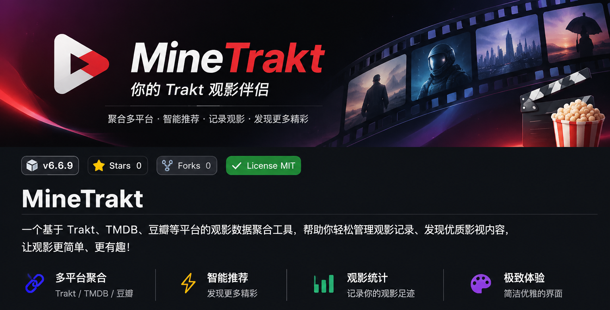

  

## 📖 项目介绍

**MineTrakt** 是一个基于 Trakt.tv 打造的影视追踪与管理工具，整合 Trakt、TMDB、豆瓣等影视数据源，为用户提供统一、便捷的观影管理体验。

通过 MineTrakt，你可以随时查看自己的观影记录、追剧进度、待看清单以及影视日历，不再需要在多个平台之间来回切换。

项目采用 Cloudflare Workers 服务端架构，结合 KV 缓存机制，优化数据请求效率与访问体验。

## ✨ 功能特性

### 🌐 在线体验
- 在线地址： https://trakt.yx1314.ccwu.cc

### 🎥 观影管理
- **继续观看**：查看正在观看的电影和剧集。
- **观看历史**：记录已观看的电影及剧集。
- **待看清单**：集中管理想看的电影和剧集。
- **追剧管理**：查看追剧进度，支持弃看及进度管理。
- **观看状态同步**：通过 Trakt 同步观影数据。

### 📅 影视日历
- 查看追剧日历。
- 追踪剧集更新情况。
- 方便掌握剧集播出安排。

### 🔍 影视发现
- 搜索电影和剧集。
- 整合 TMDB 影视资料。
- 展示豆瓣影视内容。
- 支持电影及剧集详情信息展示。

### 📊 观影统计
- 统计电影观看次数。
- 统计剧集观看情况。
- 计算累计观影时长。
- 展示热门观看电影及剧集。
- 分析观影日期及观影习惯。

### 🔐 账号授权
- 使用 Trakt Device Code 授权登录。
- 自动检测授权状态。
- 支持重新获取验证码。
- 支持退出登录。
- 安全管理授权 Cookie。

### ⚡ 性能优化
- Cloudflare Workers 无服务器架构。
- Cloudflare KV 数据缓存。
- 缓存过期与自动更新机制。
- 请求去重及并发控制。
- Trakt API 请求频率限制保护。
- 上游接口异常时尽可能使用历史缓存数据。
- 前端分模块加载，减少不必要的数据请求。

### 🎨 界面体验
- 简洁现代的影视风格界面。
- 支持深色、浅色及跟随系统主题。
- 适配桌面和移动设备。
- 加载状态及错误提示。
- 支持渐进式数据加载。

## 🧩 数据来源

| 数据平台 | 主要用途 |
|---|---|
| Trakt.tv | 账号授权、观影记录、观看进度、待看清单 |
| TMDB | 影视资料、海报及相关信息 |
| 豆瓣 | 影视内容及榜单数据 |
| OMDb | 影视信息补充 |

## 🛠️ 技术架构

- **运行环境**：Cloudflare Workers
- **服务端**：JavaScript
- **缓存存储**：Cloudflare KV
- **影视数据**：Trakt API、TMDB API
- **前端**：HTML、CSS、JavaScript
- **授权方式**：Trakt OAuth Device Authorization

## ⚙️ 环境配置

部署前需要准备相应的第三方 API 凭据。

| 配置项 | 用途 |
|---|---|
| `TRAKT_CLIENT_ID` | Trakt 应用客户端 ID |
| `COOKIE_SECRET` | Cookie 签名密钥 |
| `TMDB_API_KEY` | TMDB API 密钥 |
| `TMDB_CACHE` | Cloudflare KV 命名空间绑定 |

代码还支持通过 `TRAKT_UA_OVERRIDE` 和 `CHROME_UA_MAJOR` 调整请求 User-Agent。

请根据项目代码中的环境变量读取逻辑配置 Secrets 和 KV 绑定，不要将私密密钥直接提交到公开仓库。

## 🚀 部署说明

1. 准备 Cloudflare 账号。
2. 创建 Cloudflare Workers 项目。
3. 创建 KV 命名空间，并按照代码要求绑定 `TMDB_CACHE`。
4. 配置 Trakt、TMDB 所需的 API 凭据。
5. 配置 Cookie 签名密钥。
6. 将项目代码部署到 Cloudflare Workers。
7. 访问部署后的域名，使用 Trakt 账号完成授权。

## 🔒 安全说明

- 使用 Trakt Device Authorization 进行账号授权。
- Cookie 使用签名机制保护。
- 对跨站请求进行来源检查。
- 对授权接口增加请求冷却保护。
- 对 Trakt API 请求进行限流管理。
- 不建议将 API 密钥及 Cookie 签名密钥公开。

## 📌 注意事项

1. 使用前需要拥有 Trakt 账号。
2. Trakt、TMDB 等第三方服务的可用性会影响数据获取。
3. 部分影视资料依赖第三方 API 返回结果。
4. 当上游接口发生限流或异常时，部分页面可能暂时显示缓存数据。
5. 请合理使用第三方 API，遵守对应平台的服务条款。

## 🙏 致谢

感谢以下项目及平台提供的数据与服务：

- [Trakt.tv](https://trakt.tv/)
- [TMDB](https://www.themoviedb.org/)
- [豆瓣电影](https://movie.douban.com/)
- [OMDb API](https://www.omdbapi.com/)
- [Cloudflare](https://www.cloudflare.com/)

---

  Made with ❤️ for movie lovers.

  <strong>MineTrakt · 让每一次观影都有迹可循。</strong>

